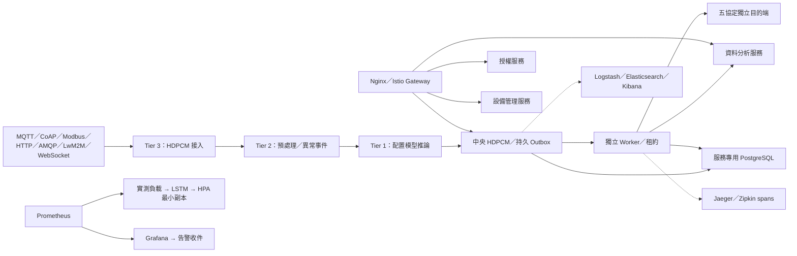

# 服務與資料流

每個角色以獨立程序／容器執行，資料庫帳號無法讀寫其他角色資料庫。共同 Python 套件重用契約及可靠投遞機制，不要求同時發布所有服務。Auth 只提供 JWT，Devices 提供業務設備資源，Analytics 保存分析收件與告警，Collector 使用獨立資料庫提供目的端證據。

Tier 3 可就近接入；Tier 2 執行明確閾值規則；Tier 1 按部署的模型權重計算。範例線性模型的權重是示範配置，不能作為工業 AI 精度成果。資料不必一律通過全部層級，路由可直接交付中央或其他目的端。

Kubernetes 實驗包含 Tier 1 控制節點、Tier 2 worker 節點，以及兩個 Tier 3 接入節點。Node affinity 指定角色，偏好反親和讓副本分布到不同 Tier 3 節點。共享 PostgreSQL 支援跨 Pod 的 `FOR UPDATE SKIP LOCKED` 與過期租約；不是以跨主機共用 SQLite 取代資料庫。

每筆接入與 Outbox 同交易提交。Worker 在交易外連線，成功後依租約 token 更新；過期 worker 不能覆寫新 worker 的結果。每個目的端有固定 UUID 投遞 ID 與設定快照。重送採至少一次語意，下游以投遞 ID 去重。永久 DEAD 工作由管理 API 重放。

Kubernetes 內的 Prometheus 使用命名空間唯讀 Pod 探索權限，逐個 scrape 接入 Pod。PROA 從該負載訓練 NumPy LSTM，以時序 75/25 切分計算 MAE 與持續值基準，只修改具名 HPA 的 `minReplicas`；CPU HPA 管理實際副本。沒有兩個控制器同時直接改 Deployment replicas。

Istio 的 DestinationRule 提供連線限制與 outlier ejection，VirtualService 提供 stable／canary 權重。HTTP ingress 使用真正 Istio Gateway；Nginx 提供 Compose 的動態 DNS 路由與限流。應用以 trace ID 串接接入、投遞及目的端 span；追蹤採有界、盡力交付的背景佇列，不列為持久收件證據。

目前 PostgreSQL、MQTT、RabbitMQ 與控制平面各是實驗單例；四個容器節點位於同一主機。這些配置驗證程序／Pod／接入節點故障，不證明主機斷電、控制平面或資料庫叢集 HA。實際部署需要獨立故障域、資料層備援與站點校時配置。
